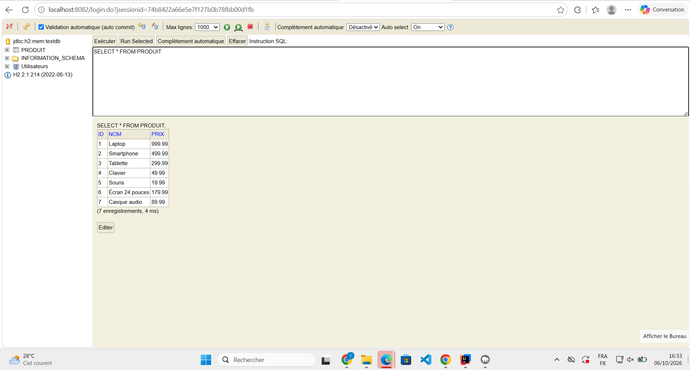
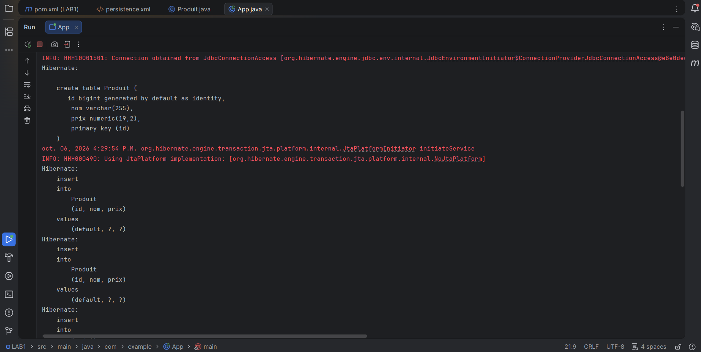
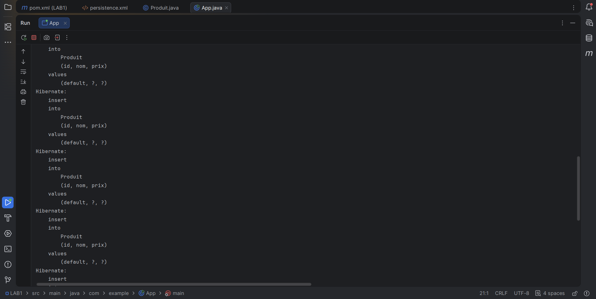
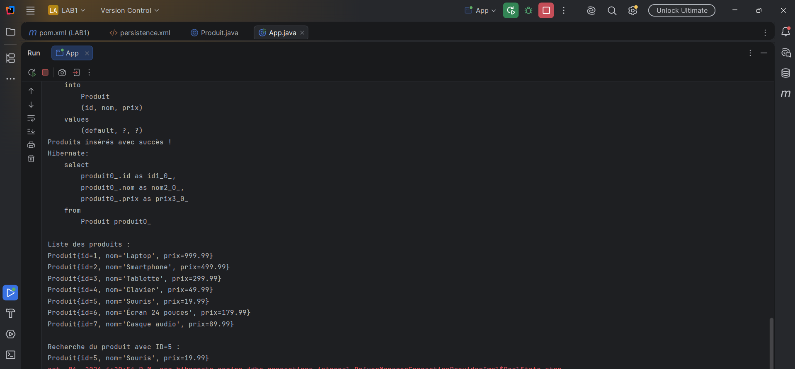
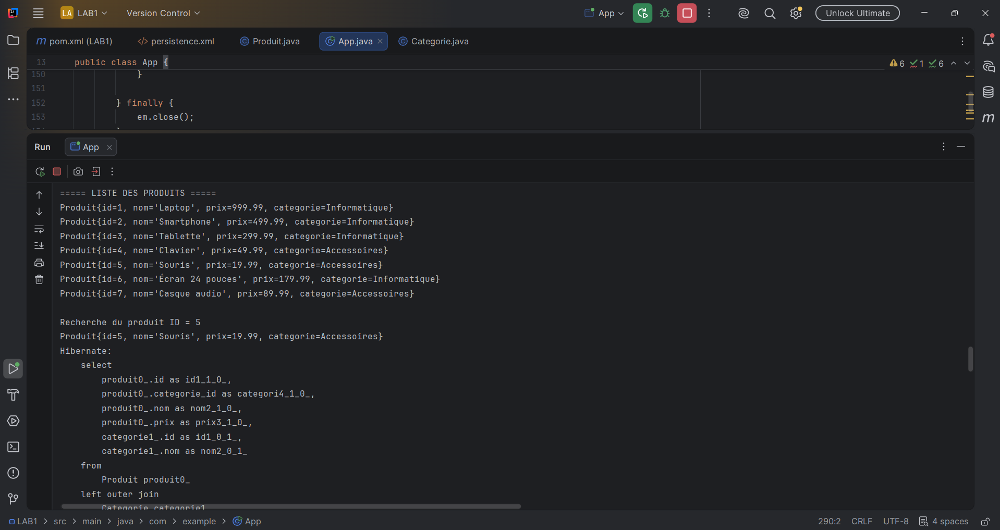
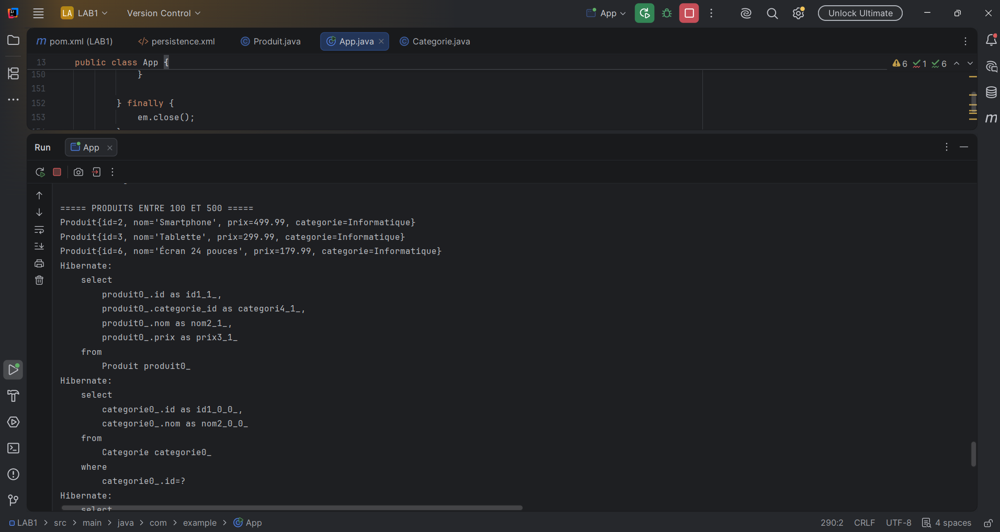
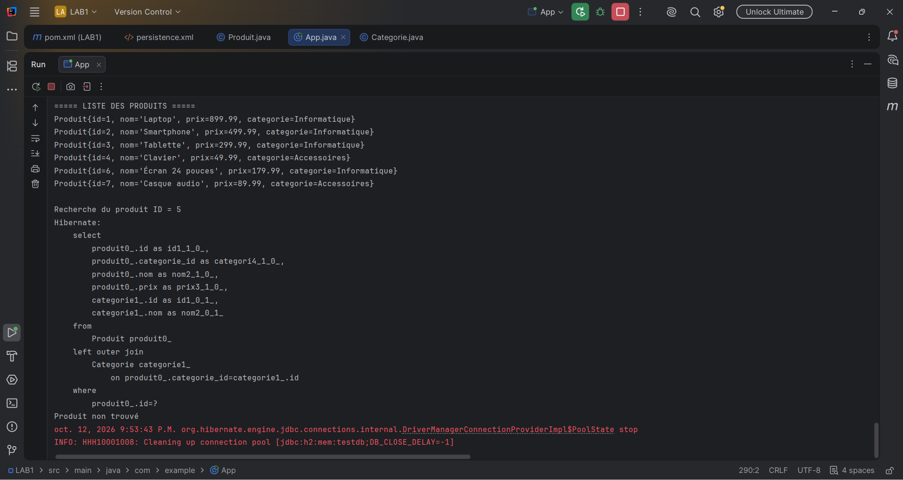

# TP1 - JPA Hibernate

## Description
Travaux pratiques sur JPA et Hibernate avec Java et Maven.

## Structure du projet
- [LAB1](./LAB1) : code source du projet
- [sreen-Shut](./sreen-Shut) : captures d'écran de l'exécution

## Captures d'écran

### Capture 1

### Capture 2

### Capture 3

### Capture 4

### Capture 5

### Capture 6

### Capture 7

